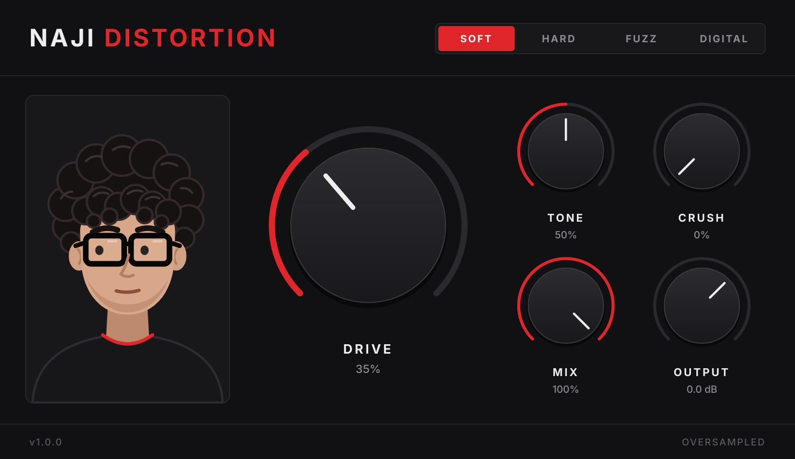

# NAJI DISTORTION

A simple, high-quality stereo distortion plugin (VST3, 64-bit). It goes from subtle warmth to
completely blown-out.



## Controls

| Control | What it does |
|---|---|
| **SOFT / HARD / FUZZ / DIGITAL** | Distortion type (see below). Switching crossfades over 30 ms, so there are no clicks. |
| **DRIVE** | Distortion amount, 0 to +48 dB into the clipper. Level is auto-compensated, so turning it up adds grit without a big volume jump. |
| **TONE** | Brightness. The low half darkens (low-pass from 600 Hz up), the top quarter adds up to +7 dB of presence. |
| **CRUSH** | Digital destruction: bit depth (16 down to 2 bits) plus sample-rate reduction (up to 32x). Works with every type. |
| **MIX** | Dry/wet. The dry path is latency-aligned, so parallel distortion never sounds phasey. |
| **OUTPUT** | Final volume, -24 to +12 dB. |

Double-click any knob to reset it.

### Distortion types
- **Soft**: asymmetric tube-style saturation into soft clipping. Warm, with even harmonics.
- **Hard**: hard clipper with a tiny knee. Tight and aggressive.
- **Fuzz**: biased, asymmetric transistor-style fuzz into a second gain stage. Buzzy and thick.
- **Digital**: sine wavefolder blended with hard clipping. Metallic, then ridiculous at high drive.

## Installing on Windows (FL Studio)

1. Get the compiled `NAJI DISTORTION.vst3` (see "Getting the Windows build" below).
2. Copy the whole **`NAJI DISTORTION.vst3`** folder into
   `C:\Program Files\Common Files\VST3\`
   (Windows will ask for administrator permission; click Continue.)
3. Open FL Studio and go to **Options > Manage plugins**, then click **Find installed plugins**.
4. Find **NAJI DISTORTION** in the list (under *Effects*) and tick the star/checkbox to make it a favourite.
5. In the Mixer, click an empty effect slot on a track and pick **NAJI DISTORTION**.

## Getting the Windows build

### Option A: let GitHub build it (no software to install)
1. Create a free account at github.com and make a new repository (it can be private).
2. Upload everything in this folder to it, including the hidden `.github` folder.
   (Easiest: on the repo page choose **Add file > Upload files** and drag the folder contents in.
   If your file browser hides `.github`, turn on "show hidden items".)
3. Open the **Actions** tab. The *Build NAJI DISTORTION* job starts by itself and takes about 10 minutes.
4. When it shows a green tick, open the run and download **NAJI-DISTORTION-VST3-Windows-x64**.
   Unzip it and you'll find `NAJI DISTORTION.vst3`.
   The same run also runs the full test suite on Windows (`test-results` artifact).

### Option B: build it yourself
1. Install **Visual Studio 2022 Community** (choose "Desktop development with C++"),
   **CMake** (cmake.org) and **Git** (git-scm.com).
2. Double-click `build-windows.bat`. It downloads JUCE and builds the plugin.
3. The plugin is at `build\NajiDistortion_artefacts\Release\VST3\NAJI DISTORTION.vst3`.

## Technical notes
- C++17, JUCE 8.0.9, CMake. VST3 only. Mono or stereo.
- Waveshaping runs oversampled: 8x at 44.1/48 kHz, 4x at 88.2/96 kHz, 2x above that.
  Linear-phase filters, latency reported to the host (about 1.4 ms).
- Every parameter is smoothed per sample. Full automation support, state saved with the project.
- Host bypass is latency-compensated.
- About 2-4% of one CPU core at 48 kHz.
- Built with the static MSVC runtime, so no Visual C++ redistributable is needed.

## Project layout
```
CMakeLists.txt              build script (downloads JUCE automatically)
Source/DistortionEngine.h   all DSP
Source/PluginProcessor.*    parameters, state, host interface
Source/PluginEditor.*       interface
Source/NajiLookAndFeel.h    knob and colour styling
Assets/naji_mascot.svg      mascot artwork
Assets/Fonts/               Inter font (SIL Open Font License, see Inter-OFL.txt)
Tests/TestHost.cpp          loads the built .vst3 and tests it (-DNAJI_BUILD_TESTS=ON)
.github/workflows/          automatic Windows build + tests
Demo/                       audio demos, screenshots, test log
```
