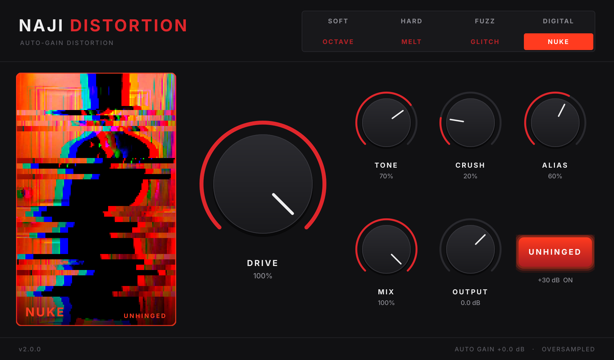

# NAJI DISTORTION

A stereo distortion plugin (VST3, 64-bit) that goes from subtle warmth to completely unhinged,
with **automatic gain compensation**: turning things up adds distortion, never volume.




## Controls

| Control | What it does |
|---|---|
| **Mode** (8 buttons) | Distortion type (see below). Switching crossfades over 30 ms, so there are no clicks. |
| **DRIVE** | Distortion amount, 0 to +48 dB into the clipper (+78 dB with UNHINGED). |
| **TONE** | Brightness. The low half darkens (low-pass from 600 Hz up), the top quarter adds up to +7 dB of presence. |
| **CRUSH** | Digital destruction: bit depth (16 down to 2 bits) plus sample-rate reduction (up to ~32x). |
| **ALIAS** | Deliberate aliasing. Blends in a copy of the distortion that runs *without* oversampling, decimates it at an odd fractional rate with no filter, and above 50% mirrors the spectrum around Nyquist. Clean and oversampled at 0, harsh inharmonic metal at 100. |
| **MIX** | Dry/wet. The dry path is latency-aligned, so parallel distortion never sounds phasey. |
| **OUTPUT** | Final volume, -24 to +12 dB. The only control that changes level on purpose. |
| **UNHINGED** | Adds up to +30 dB of extra drive and a second, slammed distortion stage on top of the current mode. |

Double-click any knob to reset it.

### Auto gain
The plugin keeps measuring the input loudness and the distorted loudness and turns the distorted
signal down (or up) to match. A calibrated per-mode estimate makes it react instantly, an adaptive
stage tracks the rest, and a peak limiter catches spikes. Result: DRIVE, UNHINGED, TONE, CRUSH and ALIAS
all stay within about +-0.3 dB of the input level (measured, every mode, see `Demo/test-results-linux.txt`).
The footer shows how much it is currently turning things down.

### Distortion types
- **Soft**: asymmetric tube-style saturation into soft clipping. Warm, with even harmonics.
- **Hard**: hard clipper with a tiny knee. Tight and aggressive.
- **Fuzz**: biased, asymmetric transistor-style fuzz into a second gain stage. Buzzy and thick.
- **Digital**: sine wavefolder blended with hard clipping. Metallic.
- **Octave**: full-wave rectifier fuzz. Octave-up, ring-mod-ish.
- **Melt**: chaotic feedback shaper. Loud notes break into unstable, screaming tones.
- **Glitch**: Gray-coded bit scrambling. Sounds like a broken converter.
- **Nuke**: fuzz, fold, rectify, bit scramble and chaos all stacked. Pure destruction.

### The photo panel
The panel shows the real photos (`Assets/Photos/`). Each control has its own photo, so touching a knob
switches the picture with a glitch transition. The picture also reacts live: DRIVE shakes, zooms and pushes
red, CRUSH pixelates and posterises, ALIAS splits the RGB channels and tears scanlines, TONE warms or cools it,
and UNHINGED adds strobing, inverted frames and the top-hat photo flashing through. With audio playing, the
shaking follows the output level.

## Installing on Windows (FL Studio)

1. Get the compiled `NAJI DISTORTION.vst3` (see "Getting the Windows build" below).
2. Copy the whole **`NAJI DISTORTION.vst3`** folder into
   `C:\Program Files\Common Files\VST3\`
   (Windows will ask for administrator permission; click Continue.)
3. Open FL Studio and go to **Options > Manage plugins**, then click **Find installed plugins**.
4. Find **NAJI DISTORTION** in the list (under *Effects*) and tick the star/checkbox to make it a favourite.
5. In the Mixer, click an empty effect slot on a track and pick **NAJI DISTORTION**.

## Getting the Windows build

### Option A: let GitHub build it (no software to install)
1. Create a free account at github.com and make a new repository (it can be private).
2. Upload everything in this folder to it, including the hidden `.github` folder.
   (Easiest: on the repo page choose **Add file > Upload files** and drag the folder contents in.
   If your file browser hides `.github`, turn on "show hidden items".)
3. Open the **Actions** tab. The *Build NAJI DISTORTION* job starts by itself and takes about 10 minutes.
4. When it shows a green tick, open the run and download **NAJI-DISTORTION-VST3-Windows-x64**.
   Unzip it and you'll find `NAJI DISTORTION.vst3`.
   The same run also runs the full test suite on Windows (`test-results` artifact).

### Option B: build it yourself
1. Install **Visual Studio 2022 Community** (choose "Desktop development with C++"),
   **CMake** (cmake.org) and **Git** (git-scm.com).
2. Double-click `build-windows.bat`. It downloads JUCE and builds the plugin.
3. The plugin is at `build\NajiDistortion_artefacts\Release\VST3\NAJI DISTORTION.vst3`.

## Technical notes
- C++17, JUCE 8.0.9, CMake. VST3 only. Mono or stereo. Version 2.0.0.
- Waveshaping runs oversampled: 8x at 44.1/48 kHz, 4x at 88.2/96 kHz, 2x above that.
  Linear-phase filters, latency reported to the host (about 1.4 ms).
- Every parameter is smoothed per sample. Full automation support, state saved with the project.
- Host bypass is latency-compensated.
- About 3-9% of one CPU core at 48 kHz (Nuke with UNHINGED and ALIAS about 12%).
- Built with the static MSVC runtime, so no Visual C++ redistributable is needed.

## Project layout
```
CMakeLists.txt              build script (downloads JUCE automatically)
Source/DistortionEngine.h   all DSP
Source/PluginProcessor.*    parameters, state, host interface
Source/PluginEditor.*       interface
Source/NajiLookAndFeel.h    knob and colour styling
Assets/Photos/              photos shown in the interface
Assets/naji_mascot.svg      original mascot artwork (v1, unused)
Assets/Fonts/               Inter font (SIL Open Font License, see Inter-OFL.txt)
Tests/TestHost.cpp          loads the built .vst3 and tests it (-DNAJI_BUILD_TESTS=ON);
                            "NajiTestHost calibrate" regenerates the auto-gain tables
.github/workflows/          automatic Windows build + tests
Demo/                       audio demos, screenshots, test log
```
