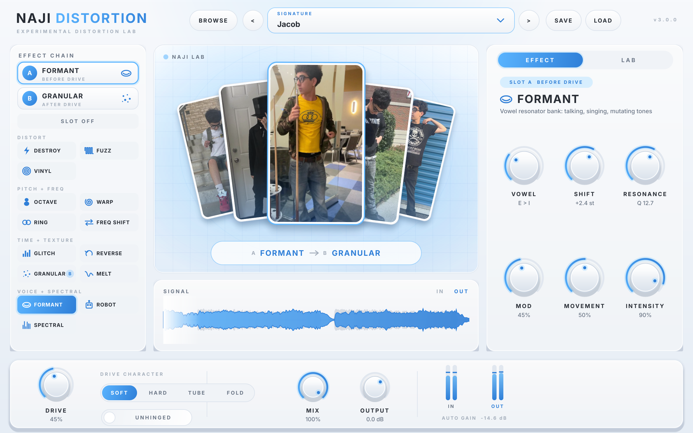
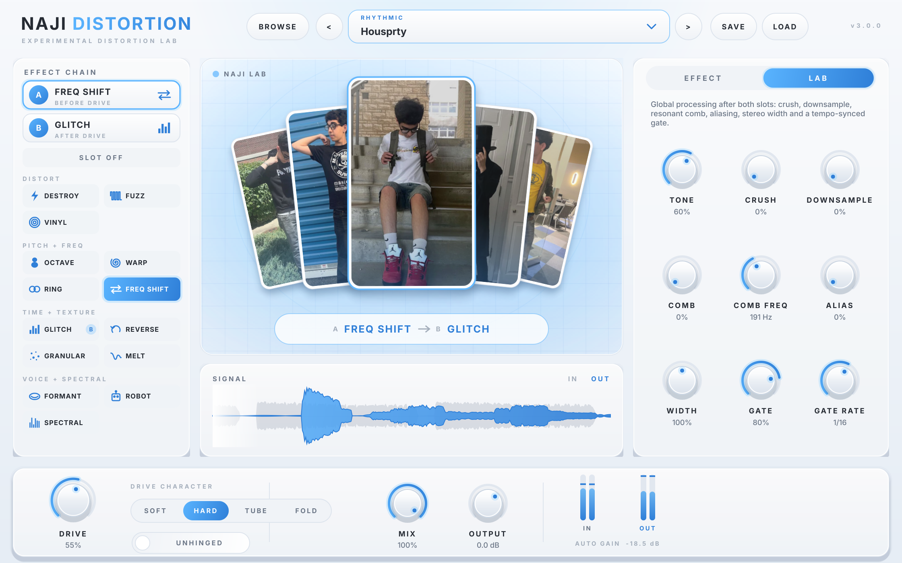
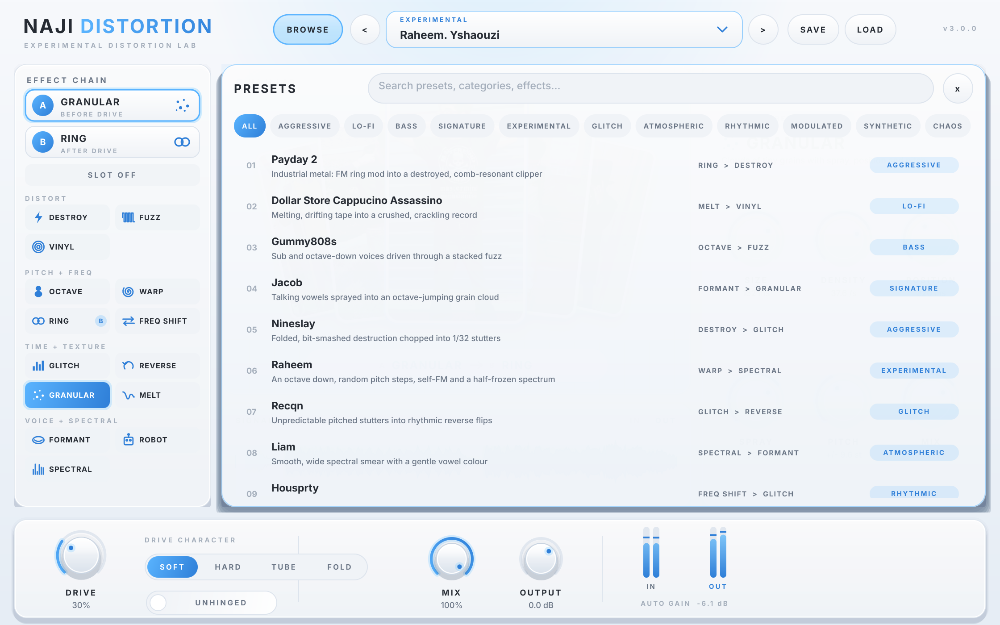

# NAJI DISTORTION

An experimental distortion lab (VST3, 64-bit, Windows / FL Studio). Two effect slots, 14 separate
DSP engines, an oversampled drive stage, a LAB section of global processing, 18 factory presets and a
searchable preset browser. Auto gain keeps the level steady, so turning things up changes the
sound, not the volume.


| Formant preset | LAB tab | Preset browser |
|---|---|---|
|  |  |  |

## Signal flow

```
in -> SLOT A effect -> DRIVE (Soft / Hard / Tube / Fold, oversampled) [+ UNHINGED]
   -> ALIAS -> SLOT B effect
   -> LAB: Crush -> Downsample -> Comb -> Tone -> Gate (tempo synced) -> Width
   -> Auto gain -> Limiter -> Mix -> Output
```

Slot A runs before the drive, slot B after it. Either slot can hold any effect or be off.
Switching an effect crossfades (20 ms) so it never clicks.

## The 14 effects

Each effect has its own engine and six controls (shown on the right when you pick a slot).

| Effect | What the DSP actually does | Controls |
|---|---|---|
| **GLITCH** | Tempo-synced buffer events: stutter loops, reversed slices, octave stutters, tape stops, digital dropouts | Slice, Chaos, Repeat, Pitch, Chop, Mix |
| **MELT** | Modulated delay (wow + random drift + envelope "sag") into a modulated 8-stage allpass smear | Wobble, Speed, Drift, Smear, Sag, Mix |
| **OCTAVE** | Real pitch-shifted -1 and +1 octave voices, analog flip-flop sub octave, rectified octave harmonics | Down, Up, Sub, Harmonics, Grain, Blend |
| **FORMANT** | 4-band vowel resonator bank morphing A-E-I-O-U, formant shift +/-12 st, resonance, LFO and envelope movement | Vowel, Shift, Resonance, Mod, Movement, Intensity |
| **DESTROY** | 4x oversampled: gain smash, hard clip, wavefolder, rectifier, bit crusher, chattering sputter gate | Crunch, Fold, Bits, Rectify, Sputter, Mix |
| **WARP** | Pitch shifter driven by a shaped LFO (sine / tri / saw / square / random steps) plus signal-driven delay FM | Bend, Sweep, Rate, Shape, FM, Mix |
| **ROBOT** | STFT robotisation (phases zeroed, frames re-emitted at the robot pitch), tuned metal comb, 30 Hz "Dalek" ring | Pitch, Robotize, Metal, Resonance, Dalek, Mix |
| **VINYL** | Wow and flutter, band-limiting + saturation + mono ageing, crackle and pops, hiss and hum | Wow, Flutter, Crackle, Noise, Age, Mix |
| **RING** | Ring modulator with an FM-modulated carrier, envelope tracking, sine-to-square shape, stereo spread | Freq, Shape, Track, FM, Spread, Mix |
| **FUZZ** | 4x oversampled transistor stages with dynamic bias, stackable 1-3 stages, gate, mid-scoop tone stack | Fuzz, Bias, Gate, Stack, Scoop, Mix |
| **GRANULAR** | Up to 48 windowed grains from a 5 s buffer: size, density, position, spray (time/pan/reverse), pitch | Size, Density, Position, Spray, Pitch, Mix |
| **SPECTRAL** | Phase vocoder: spectral freeze, bin shift, spectral stretch, blur, "thin" spectral gate | Freeze, Shift, Stretch, Blur, Thin, Mix |
| **FREQ SHIFT** | Hilbert-transformer single-sideband frequency shifter (+/-2 kHz), feedback spirals, LFO, stereo split | Shift, Feedback, Mod, Rate, Stereo, Mix |
| **REVERSE** | Double-buffered reversed slices (tempo synced), chance of reversing, feedback, fade shape, 0.5x/1x/2x | Length, Chance, Feedback, Fade, Speed, Mix |

GLITCH, REVERSE and the LAB gate follow the host tempo and lock to the song position while playing.

Note: ROBOT and SPECTRAL are frame-based (FFT). Their processed signal is about 21 ms (Robot) and
43 ms (Spectral) behind the dry signal. This is not reported as plugin latency, so with MIX below 100%
you hear it as a short offset, which suits these effects.

### Verified, not just claimed

The test host (`Tests/TestHost.cpp`) loads the compiled plugin and measures every effect. A few results
from `Demo/test-results-linux.txt` (453/453 checks pass):

- OCTAVE turns 220 Hz into 110 Hz (down, +37 dB over the original) and 440 Hz (up)
- FREQ SHIFT +300 Hz moves 1 kHz to 1300.8 Hz, the mirror sideband is 50 dB lower (true single sideband)
- RING with a 300 Hz carrier turns 1 kHz into 700 + 1300 Hz
- WARP +12 st turns 1 kHz into 1999.5 Hz; MELT moves 94% of a sine's energy off pitch
- FORMANT 'A' vs 'I' moves the resonances by 17-26 dB in the vowel bands; +12 st shift doubles them
- ROBOT turns white noise into a pitched harmonic buzz; SPECTRAL freeze keeps sounding after the input stops
- REVERSE, GLITCH and GRANULAR scramble time on a rising chirp; VINYL adds crackle and band-limits
- every pair of the 14 effects and of the 18 presets is measurably different (time-frequency fingerprint)
- each effect's Mix at 0 is bit-transparent; every preset recalls all 100 parameters exactly

## Global controls

**Bottom bar:** DRIVE (0 to +48 dB, +78 dB with UNHINGED), drive character (Soft, Hard, Tube, Fold),
UNHINGED (extra drive and a second slammed stage), MIX, OUTPUT, input/output meters and the current
auto-gain amount.

**LAB tab:** Tone, Crush (16 to 2 bits), Downsample (up to ~32x), Comb (resonant comb filter) and
Comb Freq, Alias (deliberate, unfiltered aliasing), Width (0-200%, M/S with decorrelation above
100%), Gate and Gate Rate (1/4 to 1/32, triplets).

## Presets

18 factory presets, each a different slot combination:

| # | Preset | Category | Chain |
|---|---|---|---|
| 1 | Payday 2 | Aggressive | Ring > Destroy, comb |
| 2 | Dollar Store Cappucino Assassino | Lo-Fi | Melt > Vinyl, crush + downsample |
| 3 | Gummy808s | Bass | Octave > Fuzz |
| 4 | Jacob | Signature | Formant > Granular |
| 5 | Nineslay | Aggressive | Destroy > Glitch, alias |
| 6 | Raheem | Experimental | Warp > Spectral |
| 7 | Recqn | Glitch | Glitch > Reverse |
| 8 | Liam | Atmospheric | Spectral > Formant |
| 9 | Housprty | Rhythmic | Freq Shift > Glitch, 1/16 gate |
| 10 | Raheem. Yshaouzi | Experimental | Granular > Ring, comb |
| 11 | Danzie | Modulated | Warp > Freq Shift |
| 12 | Yusuf | Atmospheric | Reverse > Spectral |
| 13 | Fuquad | Experimental | Freq Shift > Robot, unhinged |
| 14 | Anime Gamer | Synthetic | Warp (+12) > Formant |
| 15 | Dicks Sporting Goods | Aggressive | Fuzz > Ring |
| 16 | Fortnite | Glitch | Glitch > Destroy |
| 17 | Pirate Shop Token | Chaos | Warp > Fuzz, unhinged |
| 18 | Boolymon | Modulated | Melt > Formant |

**Using presets:** click the preset name for a dropdown grouped by category, use `<` `>` to step through,
or open **BROWSE** for the searchable browser (search matches names, categories, descriptions and
effect names; click to load, double-click to load and close). **SAVE** writes a `.najipreset` file
(default folder `Documents\NAJI DISTORTION\Presets`, which the browser lists under *User*), **LOAD** opens
one from anywhere. The factory presets also show up in FL Studio's own preset menu.

## The interface

- **Centre:** all five photos in a floating fan. The photo for the slot A effect moves to the front with
  an animated reshuffle; the cards bob gently, the glow and pulse rings follow the output level, and a
  light sweep runs across the front card. Under the photos: the current chain (A > B) and a live
  input/output waveform.
- **Left:** slot A / slot B and the effect list grouped by category, with icons. Click a slot, then an effect.
- **Right:** EFFECT tab (the six controls of the selected slot's effect) and LAB tab.
- Knobs glide to new values (presets, automation), the selection highlight slides, tabs and the preset
  browser animate. All animation runs on the UI thread from one 60 Hz timer; audio only talks to the
  UI through atomics and a lock-free scope buffer, so the UI can never stall the audio.

## Installing on Windows (FL Studio)

1. Download the build (see below) and unzip it. You get a folder called `NAJI DISTORTION.vst3`.
2. Close FL Studio.
3. Copy the whole `NAJI DISTORTION.vst3` folder into `C:\Program Files\Common Files\VST3\`
   (replace the old version if Windows asks).
4. Open FL Studio. New installs: **Options > Manage plugins > Find installed plugins**, then add
   NAJI DISTORTION from the Effects list. Updating: existing projects pick up the new version.

Old projects saved with v1/v2 load, but v3 is a redesign: DRIVE/TONE/MIX/OUTPUT/ALIAS/UNHINGED carry
over, the old OCTAVE/MELT/GLITCH/NUKE drive modes became the new effect engines, and CRUSH is now
bit depth only (sample-rate reduction moved to DOWNSAMPLE).

## Getting the Windows build

Every push to this repository builds the plugin on GitHub (Actions tab, *Build NAJI DISTORTION*).
When the run shows a green tick, download **NAJI-DISTORTION-VST3-Windows-x64** from the run page.
The same run also loads the built plugin and runs the full test suite on Windows.

To build it yourself: install Visual Studio 2022 (Desktop development with C++), CMake and Git, then
double-click `build-windows.bat`.

## Technical notes

- C++17, JUCE 8.0.9, CMake. VST3, mono or stereo. 44.1 to 192 kHz.
- Drive stage oversampled 8x (44.1/48 kHz), 4x (88.2/96), 2x above; DESTROY and FUZZ run their own 4x
  oversampling. Reported latency 65 samples at 48 kHz; MIX and host bypass are latency compensated.
- Every parameter is smoothed per sample; effect switches crossfade (with a short pre-roll so the new engine has
  settled); no allocation or locks on the audio thread (all engines for both slots are created in `prepareToPlay`).
- Level: each slot has a leveller that keeps its output near its input level, and the global auto gain acts like
  a compressor (down in ~120 ms, up in ~600 ms), so switching effects or presets does not jump in volume.
- CPU (one core, 48 kHz): 3.6-6.9% per effect, about 14% for the heaviest preset (Pirate Shop Token).
- The photo display animates at 30 fps while audio plays or cards move and 15 fps when idle; everything else at
  60 fps, only repainting what changed.
- Static MSVC runtime, so no Visual C++ redistributable is needed.

## Project layout

```
Source/EffectDefs.h            effect catalogue: names, parameters, value mappings, display
Source/dsp/DspCommon.h         filters, delay lines, pitch shifter, Hilbert transformer, ...
Source/dsp/Effects.h           the 14 effect engines
Source/DistortionEngine.h      main chain: slots, drive, LAB, auto gain, limiter
Source/Presets.*               factory presets, preset manager (save/load/browse)
Source/PluginProcessor.*       parameters, state, programs, meters, scope feed
Source/PluginEditor.*          editor layout and animation clock
Source/ui/                     theme, widgets, preset browser, photo stage, waveform
Assets/Photos/                 the five photos used in the interface
Tests/TestHost.cpp             loads the built .vst3 and tests it (-DNAJI_BUILD_TESTS=ON)
Demo/                          one rendered demo per preset, screenshots, test log
```
